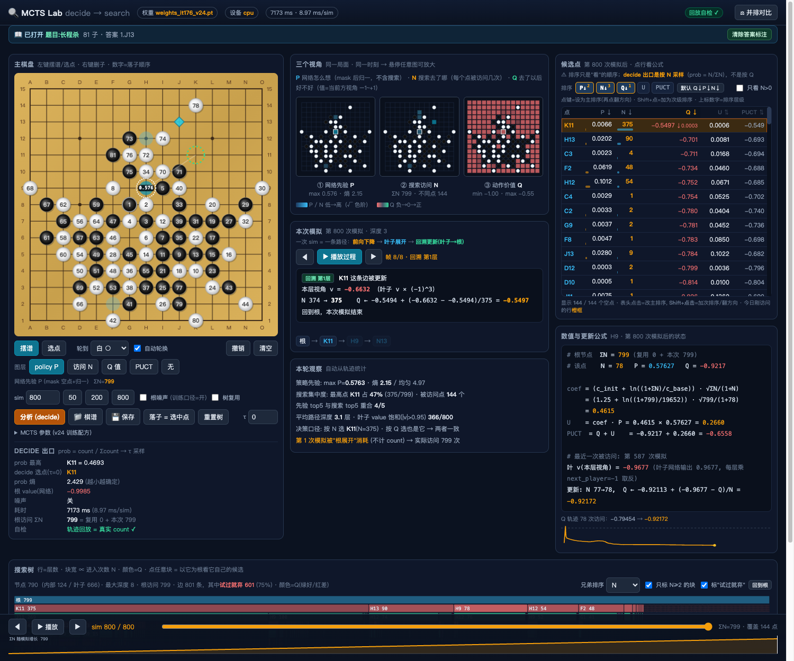
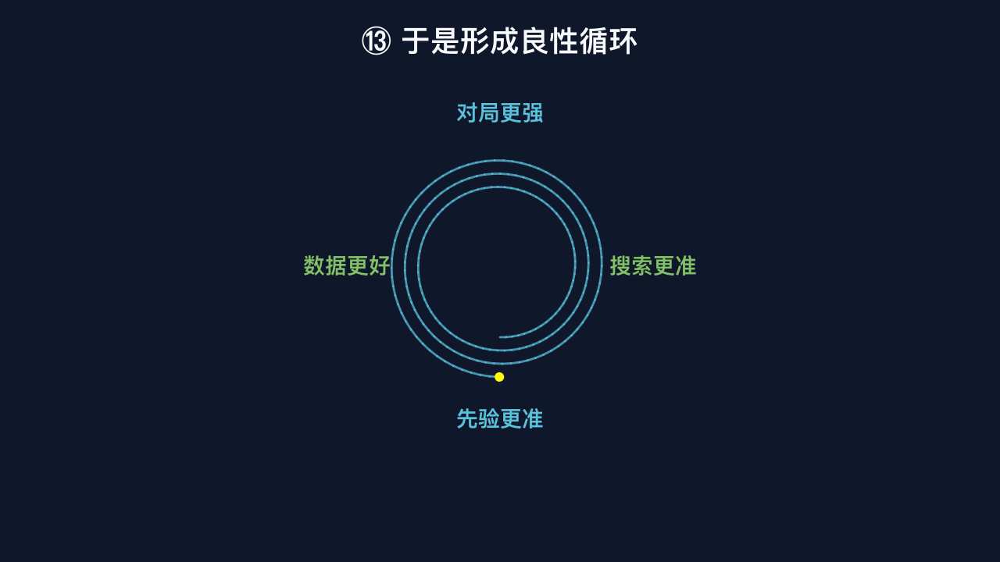
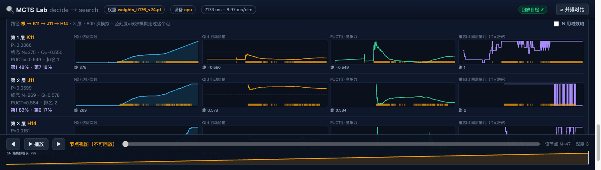
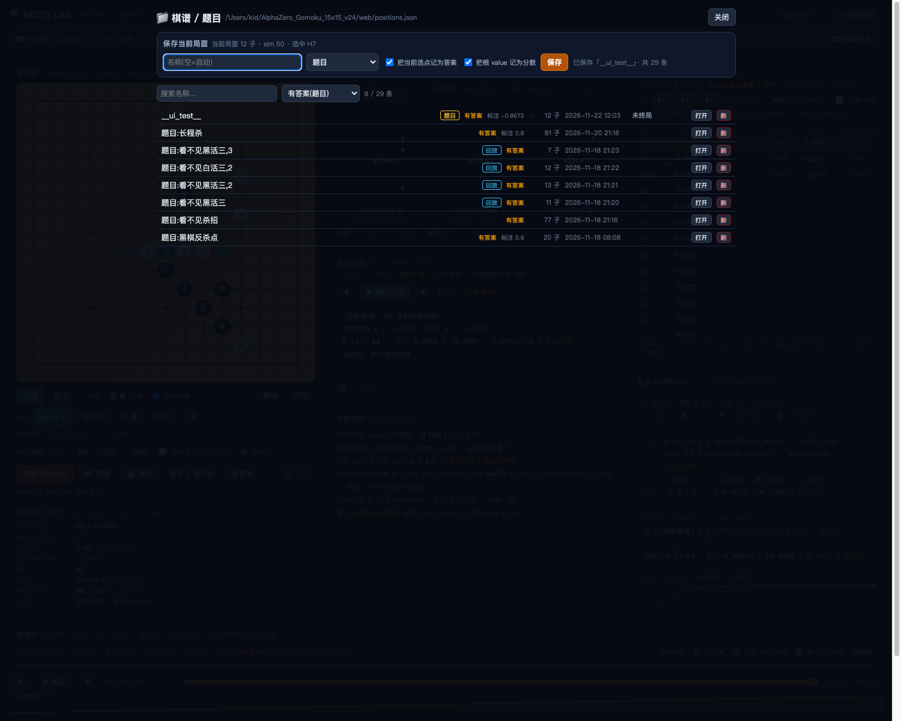
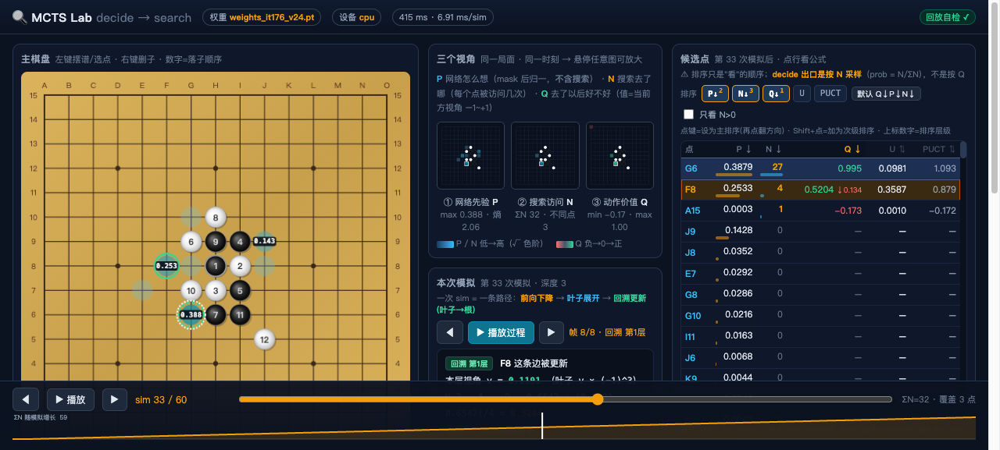
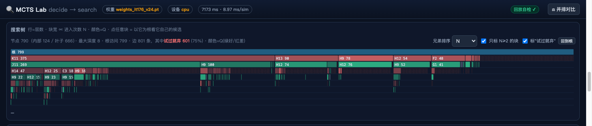
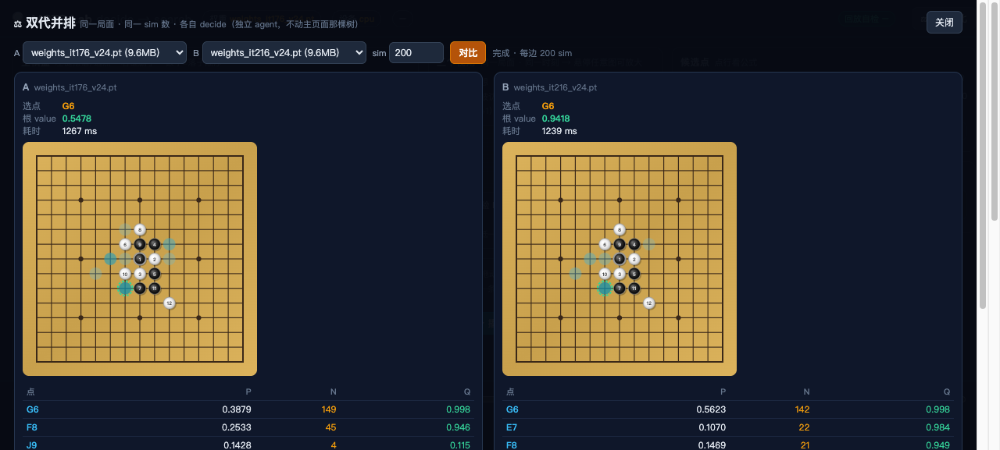
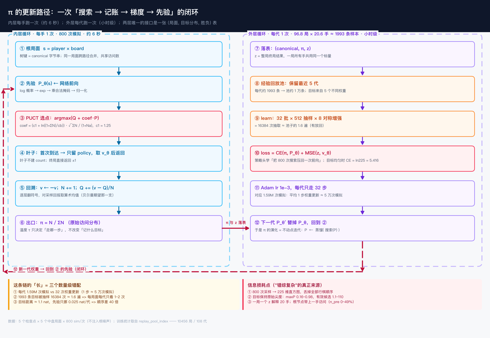
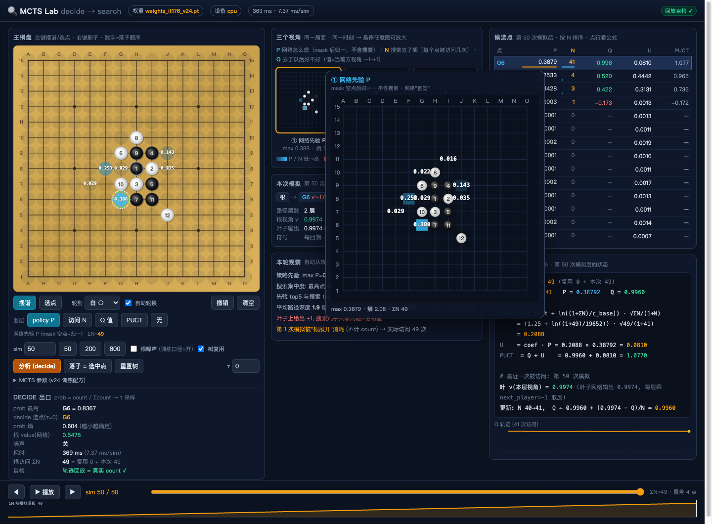
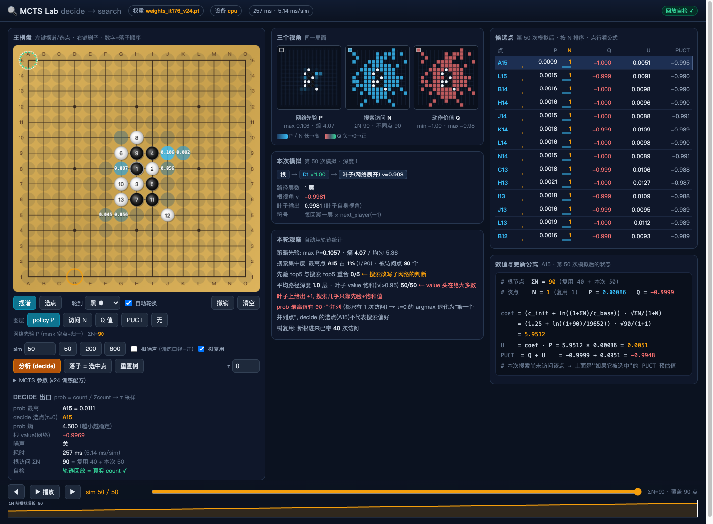

# Gomoku MCTS Lab

**AlphaZero 式五子棋的 MCTS 决策过程可视化 / 调试器。**

给一个局面，把「网络先验 → N 次模拟 → 最终选点」这条链路整个摊开：
每次模拟走了哪条路径、每个点被访问几次、Q 怎么一步步入账、树长成什么形状、
一条分支什么时候被"养大"、什么时候被"抛弃"。

适合回答这类问题：

- 网络明明看好 A，为什么最后选了 B？
- 某个点的 Q 是怎么变成 −0.96 的？是哪几次模拟把它拽下去的？
- 800 次模拟的预算花在哪了？为什么树只往横长、不往深钻？
- 两副权重在同一局面上差多少？差在置信度还是分布形状？
- 我标注的正确答案，模型给了它几次访问？

**它不改被测代码**：后端用 `importlib` 直接加载训练脚本原文件（仓库自带一份冻结快照），
只在外层包一层追踪器记录每次 `search()` 的递归路径 —— 所以画出来的永远是那份代码真实发生的过程，
不会和源码漂移；换一个网络、换一份权重，可视化照样成立。



下面所有截图都来自同一个真实局面：一盘 81 子的中后盘（白先），人工标注的正确答案是 `J13`。

| | 人工标注答案 | 模型搜 800 次的结果 |
|---|---|---|
| 选点 | **J13** | **K11** |
| 访问 N | 9 | 375 |
| prob | 1.1% | 46.9% |
| 网络先验 P | 0.028 | **0.0066** ← 网络几乎没看上它 |

**先验只有 0.66% 的 K11 被搜索推成了第一选择**（因为它的 Q=−0.568 是这盘"已经判负"（根 v=−0.9985）里相对最不坏的），
而标注的答案 J13 只被看了 9 次。这个 lab 的用处就是把这种差距摊开：
先验怎么想 → 搜索怎么改 → 每个点什么时候被养大、什么时候被抛弃。

## 视频：从人类读棋到良性循环

**[▶ 3 分 25 秒，1280×720](video/mcts_explained_720p.mp4)** — 一个完整的科普讲解片，全部数字来自本仓库的实测，不是示意。



它讲的是这张图里的整条链路，顺序是：

| 幕 | 内容 | 关键数字 |
|---|---|---|
| ① | 人类怎么读棋：先筛 4 个点，再读 3 手 | 白 (8,8) 成活四即胜 |
| ② | 计算机没有这个直觉，只能全试 | 200^20 ≈ 10^46 |
| ③ | 差别不在算得多深，在于看得准不准 | 只看 4 点 vs 全部 200 点 |
| ④ | MCTS 四阶段：选择 / 扩展 / 模拟 / 回传 | — |
| ⑤ | rollout 的致命问题 | 2000 次稳定 52%，网络说 35% |
| ⑥ | 探索 vs 利用 | A 被访问 8 次后 U 只剩 0.040 |
| ⑦ | 神经网络替掉两件事：模拟到终局 + 该看哪里 | 前 10 点占 97% 先验质量 |
| ⑧ | 逐步走一次 decide（本片核心） | 真实 trace，sim #1～#4 |
| ⑨ | 树一层层长开，只往一条路加深 | 790 局面 / 75% 的边只走一次 |
| ⑩ | 算完了：访问最多的点就是答案 | (8,8) 84.6% |
| ⑪ | 自己跟自己下成千上万局 | 10,456 局 / 108 代 |
| ⑫ | 数据反过来训练先验 | KL(网络‖搜索) 0.49~1.41 |
| ⑬ | 良性循环 | 先验更准 → 搜索更准 → 数据更好 |

源码和素材都在 [`video/`](video/)，见那里的 [README](video/README.md) —— 一条命令就能重渲。

## 启动

```bash
./run.sh                  # → http://127.0.0.1:5055
lsof -tiTCP:5055 -sTCP:LISTEN | xargs kill     # 停
```

仓库是**自包含**的：`vendor/` 里是一份冻结的训练脚本快照，`weights/` 里是演示权重
（文件名沿用训练侧的命名习惯）。克隆下来找得到 python 环境就能跑，不需要另配路径。

依赖：`flask` / `numpy` / `torch` / `gym` / `boardgame2`。
`run.sh` 按 `$PY` → 仓库内 `.venv` → 本机训练 venv → `python3` 的顺序找解释器。

要换权重/换版本（比如测 it200、或者换 v36 的网），用环境变量覆盖即可：

```bash
PY=/path/to/venv/bin/python \
V24_PY=/path/Gomoku-v0_pt_vXX.py \
V24_W=/path/weights_itXXX_vXX.pt \
LAB_PORT=5055 \
./run.sh
```

### ⚠️ 关于库里的演示权重

`weights/` 里那副权重是**训练中途的一副快照，仅作演示/复现界面行为用**：

- **不代表项目最强水平**，也不保证棋力、不保证代表性与稳定性（那一代之后还在继续训练）
- 用它复现出来的现象（含 value 头饱和、搜索散开）**是这副权重的真实行为**，不是 bug
- 想复现自己的实验，请用 `V24_W` 指到你自己的权重（这个环境变量名沿用脚本侧的命名，含义就是"被测权重文件"）
- 文件 9.6 MB，`sha256 ed21329a…f0a67`（仅用于校验文件完整，**不用于判断权重同一性**——
  权重同一性要比 tensor 值，不能比字节/md5）

## 页面怎么用

**move 轴（一步步往下走）**
1. 左键点棋盘摆谱（数字=落子顺序），右键删子，「轮到谁」自动推断，可手改
2. `分析 (decide)` → 50 次模拟，树建好
3. 「选点」模式点任意空点 → 右侧公式面板显示该点的 P/N/Q/U/PUCT 与最近一次更新
4. `落子 = 选中点` → 走一手，**子树保留成新根**再分析（看到 `复用 40 + 本次 50`）

**sim 轴（搜索过程回放）**
- 底部滑杆 0↔50（或 200/800）拖任意切点，三张热力图、候选表、公式数值全部按该时刻重算
- `▶ 播放` 连续播放；每次只拖动不重发请求（一次拿全部轨迹，前端本地重放）

## 四个面板在说什么

| 面板 | 内容 |
|---|---|
| 主棋盘图层 | `policy P` 网络先验 / `访问 N` / `Q 值` / `PUCT` |
| 三个视角 | 同一局面 P/N/Q 三张对照图（悬停任意图→弹出 420px 放大版，带坐标与数值标注；挪开收起） |
| 本次模拟 | **逐帧播放一次 search**：起点 → 前向逐层（每层带 ΣN/P/Q/coef/U/PUCT/排名/次名）→ 叶子展开（网络 v）→ 回溯逐层（N→N+1、Q 更新，叶子→根） |
| 候选点 | **全部空点列出**（滚动条）· P/N/Q/U/PUCT 五个键都能排序：点键=主排序(再点翻方向)、Shift+点=加次级(上标=层级)、`默认`=回 **Q↓→P↓→N↓** · 刚被访问的行橙框 + Q 四位小数带 ↑↓ |
| 数值与更新公式 | `coef`、`U=coef·P`、`PUCT=Q+U`、`N→N+1, Q←Q+(v−Q)/N` 全部带数 + Q 轨迹折线 |
| 本轮观察 | 自动统计：先验熵、集中度、先验↔搜索 top5 重合、平均深度、value 饱和率、计数平局、argmaxN vs argmaxQ |
| 搜索树 | 冰柱图：行=层数，**块宽 ∝ 进入次数 N**，颜色=Q；兄弟块可按 **N / Q / P** 重排；`试过就弃`（N=1 且 Q<0）用红色虚线框标出。点任意块 → 以该节点为根，重绘棋盘/三视角/候选表/公式；顶部显示 `根 → G6 → J4` 路径，`回到根` 复原 |
| 棋谱 / 题目 | `📁 棋谱` 打开列表（搜索 / 标签 / 有答案过滤），点任一条**直接加载局面并重算**；带 `answer` 的题目会在棋盘上用青色菱形标出推荐点。`💾 保存` 把当前局面存成题目/对弈，可勾选"当前选点记为答案""根 value 记为分数" |
| 路径曲线 | 点「搜索树」里任意节点 → 画出 `根→该节点` 这条路径上**每一层**的 N(t) / Q(t) / PUCT(t) / 排名(t)，x=模拟次数；底部橙色竖刻度=哪几次模拟真的走过这个点；悬停任意一张图可让所有行同步到同一 t 读数 |
| 双代并排 | 头部 `⚖ 并排对比` → 选两副权重、同一局面同一 sim，各自 decide；并排看 policy 热力、选点、根 value、候选表 + 差异（选点是否一致 / Δvalue / policy KL / max ΔP / 访问 top5 重合） |

## 路径曲线：一个点是怎么被搜索"养大"或"抛弃"的

树只给你**终态**（N=375、Q=−0.550）。路径曲线给的是过程。实测「长程杀」里一条 `根→K11→J11→H14`（800 sim）：

| 层 | 点 | 终态 | 排名分布 |
|---|---|---|---|
| 1 | K11 | N=375, Q=−0.550, PUCT=−0.549 | **第1 48% · 第7 18%**（在榜首和第七之间来回跳） |
| 2 | J11 | N=269, Q=+0.578, PUCT=0.584 | 第2 83% · 第1 17%（稳定压在第 2） |
| 3 | H14 | N=47, Q=−0.164, PUCT=−0.158（终态第1） | 第5 29% · 第4 25%（末段才登顶） |



一眼能看出来的三种形态：
- **N(t) 是 S 曲线**：K11 前 100 次猛涨、之后平台；J11 起步更晚但斜率更陡
- **Q(t) 有台阶**：K11 的 Q 有几次明显的垂直跳（单次叶子就能把均值拽动，N 越大越拉不动）
- **排名(t) 是阶梯**：K11 在第 1 和第 7 之间高频互换 = 和 J11 抢预算的拉锯；J11 则长期钉在第 2

> 注意 Q 的符号每层都在翻转（K11 −0.55 → J11 +0.578 → H14 −0.164），这是回溯时
> `v = next_player · next_v` 每层取反的结果，不是数据错。

### 是怎么算出来的（全是前端重建，后端不再跑）

对路径上每一层 `d`（父路径 `p`、落点 `a`）：

- `N_d(t)` = 前 t 次模拟里走过这条边的次数
- `Q_d(t)` = 这些模拟回传的 `v[d]` 的滚动均值（与被测实现的 `Q ← Q + (v−Q)/N` 同式）
- `ΣN_p(t)` = 前 t 次模拟里"从父节点选了任何一个子"的次数 = 实现里的 `count[p].sum()`
- `PUCT_d(t) = Q_d(t) + coef(ΣN_p, N_d) · P_d`，`P_d` 取树里这条边的先验
- `排名_d(t)` = 同父下（已被访问过的）兄弟按 PUCT 排序的名次

**自检**：曲线末值必须等于树里那条边的终态 `N/Q`，且 `ΣN` 等于父节点 count 总和——
实测 3 层路径 `bad: []`（逐项相等）；换 800 sim 再测仍全是 0 差异。

## 棋谱 / 题目：和旧看板共用一份数据

默认直接读写旧看板那份 `positions.json`（放在 `$HOME` 下的训练项目里，单一真相源，
不用在两个工具之间搬数据），用 `POSITIONS_FILE` 可以指到别处（仓库自带 `weights/` 里没有棋谱，
第一次跑时如果这个文件不存在，就会落到本目录的 `positions.json`）：

```bash
POSITIONS_FILE=/path/to/positions.json ./run.sh
```

- 记录格式与原看板完全一致：`{name, tag, stones:[{r,c,v}], answer:[{r,c}], score, meta, created}`
  → 在 lab 里存的东西**旧看板也能打开**，反之亦然
- `stones` 的**数组顺序就是落子顺序**（棋盘上的手数），加载时按 `index+1` 还原
- 列表支持：名称搜索、`tag` 过滤（对弈 / Rapfi测评 / 回放）、`有答案(题目)` 过滤
- 保存时可勾选：`把当前选点记为答案`（取「选点」模式下选中的点，没选则取本次 decide 的选点）、
  `把根 value 记为分数`（当前方视角 −1~1）
- **第一次写入前会自动把原文件备份成 `positions.json.bak`**（这份文件属于训练项目，防手误覆盖）
- `positions.json` 已进 `.gitignore` —— 个人棋谱不进仓库



## 一次 search 的内部过程（逐帧）

「本次模拟」面板可以一帧帧走完一次 `search()`，这是递归实现的真实时序：

```
帧1 起点        根局面，进入 N 次
帧2 前向 第1层   根 → F8   排名 1/213  ΣN=31 P=0.2533 Q=0.6542
                 coef = (c_i+ln((1+ΣN)/c_b))·√ΣN/(1+N) = 1.7422
                 U = coef·P = 0.4413   PUCT = Q+U = 1.0955   次名 G6=1.0917（只差 0.0038）
帧3 前向 第2层   F8 → E7   ΣN=2 ...
帧4 前向 第3层   E7 → A15  ΣN=0 → coef=0 → 全点 PUCT=0（全平局）→ 取扫描顺序第一个
帧5 叶子展开     网络输出 v = -0.1191（该叶子自身视角）· 本次调用不加任何 count
帧6 回溯 第3层   A15   v=+0.1191  N 0→1  Q 0.0000→0.1191
帧7 回溯 第2层   E7    v=-0.1191  N 1→2  Q 0.0289→-0.0451
帧8 回溯 第1层   F8    v=+0.1191  N 3→4  Q 0.6542→0.5204  回到根，本次模拟结束
```



两个容易忽略的点：

- **回溯是从叶子往根**的（递归返回时才更新），而且每上一层 `v` 乘一次 `next_player(−1)`，
  所以同一组帧里 `+0.119 → −0.119 → +0.119 → −0.119` 交替
- **新展开节点的第一层是"全 0 平局"**：`ΣN=0 → coef=0 → U=0 → Q 也还是 0`，所有合法点 PUCT 相同，
  `nanargmax` 取棋盘扫描顺序的第一个 → 这就是 A15/A1 这类角落反复出现的机制，不是网络偏好

## 搜索树怎么读

树是**所有模拟累积**出来的，不是某一次模拟的路径（单次路径在「本次模拟」面板）。

- **行 = 层数**：第 0 行是根，第 1 行是根的所有候选，往下依次
- **块宽 ∝ N**：宽度就是"搜索预算分了多少给这个分支"；同一父节点下的块加起来不超过父块的宽度
- **颜色 = Q**：绿 = 对该方有利，红 = 不利，灰 = 接近 0；根块是蓝色（没有父边）
- **点任意块** → 该节点成为"根"：棋盘换成那个局面（多出路径上的手数），三视角/候选表/公式全部换成**它自己的** 225 个候选。
  节点视图是**静态终态**，不能用模拟轴回放（后端没有为每个节点存逐次轨迹）



上图就是「长程杀」这盘 800 次模拟的树：**节点 790（内部 124 / 叶子 666）· 最大深度 8 · 根访问 799**，
宽度按访问量分配时几乎全压在 `K11(375)` 和 `J11(269)` 两条主脉上，其余是密密麻麻的 1px 细线。

**84% 的节点是叶子（N=1）**，树是"扫把形"——预算摊在一大片只探过一次的点上，而不是往深处钻。
配合「本轮观察」里的 `叶子 value 饱和 591/800` 一起看：值头饱和 → 每个新叶子都返回 ±1 → PUCT 无从比较 → 继续开新点。
红色虚线框标的是 **"试过就弃"**（N=1 且 Q<0）：这盘 **601/801 条边（75%）** 只探过一次、价值为负、之后再也没回来。

### 节点的 N 是什么口径

`N(节点) = 进入该节点的次数 = 父节点那条边的计数`（就是 decide 里 `prob = count/Σcount` 用的数）。
根没有父边，用 `count` 总和。

⚠️ 这套实现只给**内部节点**建 `count`（叶子的 `policy` 有、`count` 没有：展开后直接返回，由父节点 +1）。
所以叶子节点的 N 取自父边计数，显示为 1（被到达一次就展开了，再来就会变成内部节点）。
后端有一致性自检：导出的树与"从模拟轨迹重建的树"逐节点比对，200/200 路径与 N 全等。

## 排序 ≠ 选点口径

候选表默认按 `Q↓→P↓→N↓` 排（方便看哪些点价值高），但 **decide 的出口是按访问次数 N 采样**：
`prob = count / Σcount`，再按温度 τ 抽（τ≤0.01 = argmax N）。**不是 argmax Q**。

原因（实测 200 次模拟，中盘局面）：

- argmax Q 与 argmax N 在 200 次模拟里只分叉 2 次（k=3、k=16），且分叉时 Q 榜首都只有 **N≤2** 的样本
- 分叉样例：k=3 时 `A15(N=1,Q=−0.173)` vs `G6(N=1,Q=+0.997)` —— 两个都只有单次叶子采样，Q 就是在比"哪次前向传播恰好给了高分"
- 值头饱和时更危险：同一局面 200 次模拟里 **191/200 个叶子 |v|>0.95**，N=1 的 Q 会直接是 ±1.000
- N 是"搜索预算分配的结果"，方差小；Q 是均值，样本少时方差大。PUCT 内部已经用 Q 引导访问，所以搜索成熟后两者天然一致（这就是为什么最终都指向 G6）

页面「本轮观察」会实时对比这两个口径，分叉时标红并注明 Q 榜首的样本数。

## 双代并排

同一个局面、同一个 sim 数，两副权重各自跑一次 decide，并排看差异。用**独立的未追踪 agent**，
不碰主页面那棵树。



实测两副不同代次的权重（同一中盘局面，各 200 sim）：两边都选 G6，但

- 根 value：**0.5478 vs 0.9418**（Δ 0.394）—— 新一代对同一个局面自信得多
- G6 的先验：0.3879 vs 0.5623 —— 新一代更集中
- `policy KL(A‖B) = 0.356`、`max|ΔP| = 0.174`、访问 top5 重合 **3/5**

选点一样不代表两代一样；置信度和分布形状的差别，正是 value 头那个老问题的直观影像。

## 口径（和训练一致 / 不一致的地方）

- **sim=800 = 训练口径**；默认 50 只为看得清、点得快（CPU 5~8 ms/sim，800 约 6 s）
- **根噪声默认关**（`训练口径=开`）：开 = 根先验混 `Dirichlet(α=0.03)`、ε=0.25，只注入一次，全部 sim 共用
- `τ` 默认 0（argmax）；训练是 `τ = max(0.05, exp(−(step−4)/8))`
- **树复用**默认开：实现只在每局开始 `reset_mcts()`，所以回合间子树保留，新根进场就带上一手的访问数
- 刷新页面 = 新会话，会自动 `reset_mcts()`（否则 ΣN 会莫名翻倍）

## π 是怎么被更新的（搜索 → 记账 → 梯度 → 先验）

本工具看的是**一次** search。但训练真正在改的是另一个东西：网络给出的先验 `P_θ`。它被更新的路径是一条两层闭环——这页上所有面板看到的东西，都只是这条链的第一环。



一条链走完是这样：

- **内层（每手）**：先验 → 800 次 PUCT → 叶子 `v_θ` → 逐层回溯 → `π = N/ΣN`。出口的 π 就是「这一手 800 次模拟的结论」。
- **温度不改变目标**：`τ` 只决定**走哪一步**（采样用 `exp(logπ/τ)`），而 `decide` 返回并记账的 `prob` 永远是**原始访问分布**。所以「训练目标被温度压平」这个说法是错的。
- **外层（每代）**：把 `(局面, π, z)` 落表 → 回放池 → 抽样 → `CE(π, P_θ) + MSE(z, v_θ)` → 权重走几步。
- **于是 π 的演化是不动点迭代**：`P ← 蒸馏(搜索(P))`。搜索比先验强出的那一点差值，就是这一代能搬动的全部。

量级（示例训练：15×15、9 工人 × 10 局/代、800 sim/手、池保留 5 代）：

| 量 | 数值 |
|---|---|
| 每代对局 × 手数 | 96.8 局 × 20.6 手 ≈ **1993 条** `(局面,π,z)` |
| 每代模拟次数 | ≈ **1.59M** |
| 每代权重更新 | **32 步**（`batches=32` × 512 抽样 × 8 对称增强） |
| 换算 | **1 步梯度 ≈ 5 万次模拟** 得出的结论 |
| 目标与先验的距离 | KL ≈ **0.5 ~ 1.4 nat**（5 个检查点 × 5 个中盘局面） |
| 先验的代际漂移 | **0.020 ~ 0.030 nat/代** |

两个容易忽略的点。**第一个在本工具里直接看得见**：树在同局内复用，所以第 k 手的根 `count` 里带着上一手留下的访问——实测 8 手依次是 `0% / 43.9% / 34.1% / 49.2% / 1.2% / 27.3% / 4.3% / 31.9%`，**平均约 24% 的训练目标分母不是这一手搜出来的**（是在父局面、不同噪声下搜的）。

**第二个只能在外面量**：目标常常比先验尖得多（实测 `maxP` 0.083~0.982、有效候选 1.1~110，而先验一般 4~28），这构成"目标越尖 → 先验越尖 → 下一轮探索越少"的正反馈环。你在本页看到的"树是扫把形""试过就弃 75%"就是同一条环的另一面。

## 自检

后端每次分析都会用轨迹重放 count 增量，与 `agent.count` 的真实增量逐格比对，结果放在右上角徽标与「decide 出口」里（`回放自检 ✓`）。前端 Q 也是同一条轨迹重放出来的，实测与 `agent.q` 差 < 1e-5（float32 舍入）。任何一处对不上就是红的，不会静默。

## 截图

| 悬停三视角 → 弹出 420px 放大版（带坐标与数值标注） |
|---|
|  |

### lab 自己抓出来的两种病

**① value 头饱和 → 搜索被打散**：白走 G6 后轮到黑，50 次模拟落在
**50 个不同点、每个 N=1、Q 全是 −1.000**，`prob` 出现 90 个并列 → `argmax` 退化成"第一个合法点"。



页面「本轮观察」会直接标红：

```
叶子 value 饱和(|v|>0.95) 50/50  ← value 头在绝大多数叶子上给出 ±1
prob 最高值有 90 个并列 → τ=0 的 argmax 退化为"第一个并列点"
平均路径深度 1.0 层
```

**② 树是"扫把形"**：800 次模拟里 84% 的节点只被探过一次（见上面「搜索树」那张图），
75% 的边"试过就弃"。预算全摊在浅层，深度 8 存在但几乎没内容。

## 仓库结构

```
server.py                     # Flask 后端: 加载被追踪的原模块 + 追踪器 + /api/analyze
static/index.html             # 单页前端(棋盘/热力图/候选表/公式/模拟轴), 无外部依赖
run.sh                        # 一条命令启动(自动找解释器, 可用环境变量覆盖)
vendor/Gomoku-v0_*.py         # 冻结的训练脚本快照 —— 被追踪的就是它, 一行未改
weights/*.pt                  # 演示权重(见上面 ⚠️ 说明)
docs/                         # 截图
```

接口：

- `GET  /api/status` — 当前权重/设备/树规模
- `POST /api/reset` — `agent.reset_mcts()`
- `POST /api/analyze` — 摆谱写 `stones:[[r,c,v],…]`，返回**一次 decide 的完整轨迹**：
  每模拟的路径 `{a:[[r,c],…], v:[逐层v], k:[leaf|node|terminal]}`、根策略、访问数、Q、`tree`、以及 `selfcheck`
- `POST /api/node` — 传 `{"path":[[r,c],…]}`，重演到树中任意节点，返回**该节点自己的 225 个候选**
  （`policy` / `count` / `q` / `stones` / `n_total`）。叶子节点也能查（有 policy 就够）
- `GET  /api/positions?q=&tag=&has_answer=1` — 棋谱列表（新→旧）
- `GET  /api/positions/get?name=` — 单条完整记录
- `POST /api/positions/save` — `{name,tag,stones[[r,c,v]…],answer[{r,c}…],score,meta}`（同名覆盖）
- `POST /api/positions/delete` — `{name}`
- `GET  /api/weights` — 可用权重清单（仓库 `weights/` + 训练目录的 `*.pt`）
- `POST /api/compare` — 传 `{"stones":…,"sim":…,"weights":[A,B]}`，两副权重各自独立 decide 一次，
  返回各自 `policy/count/q/chosen/v_root/ms`（用独立 agent + `reset_mcts`，不碰主页面的树）
- 一次请求返回全部轨迹（800 sim ≈ 200KB），前端本地重放 → 拖滑杆零延迟、不重复打网

## 已知限制

- **单会话**：树存在服务端一个 agent 里，两个标签页会互相干扰（换页先刷新）
- 树浏览器目前是**冰柱图 + 点击下钻**；没有力导向/折叠树视图，也没有"按 Q 重排兄弟节点"的选项
- 节点视图只能看到该节点的**终态**统计，看不到它内部每次模拟的轨迹（后端未按节点存）
- 双代并排只给"各自 decide 一次 + 摘要"，不做逐 sim 交叉对比，也没有棋力结论（要强度请跑 PK）
- 每次并排会把新权重加载进内存（约 10MB/副），换多了会堆着
- 噪声注入用 `np.random`，要可复现就传 `seed`
