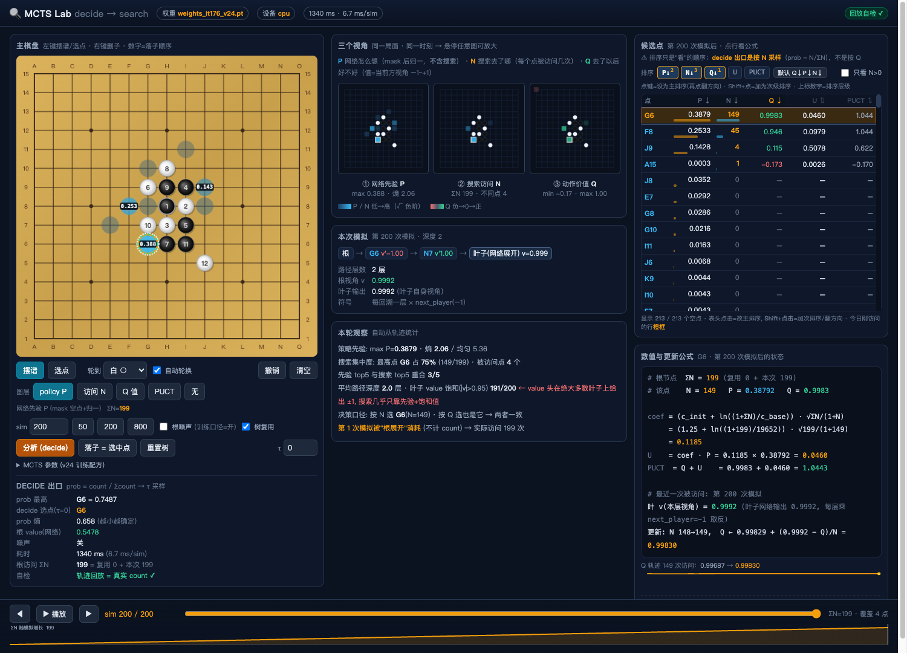
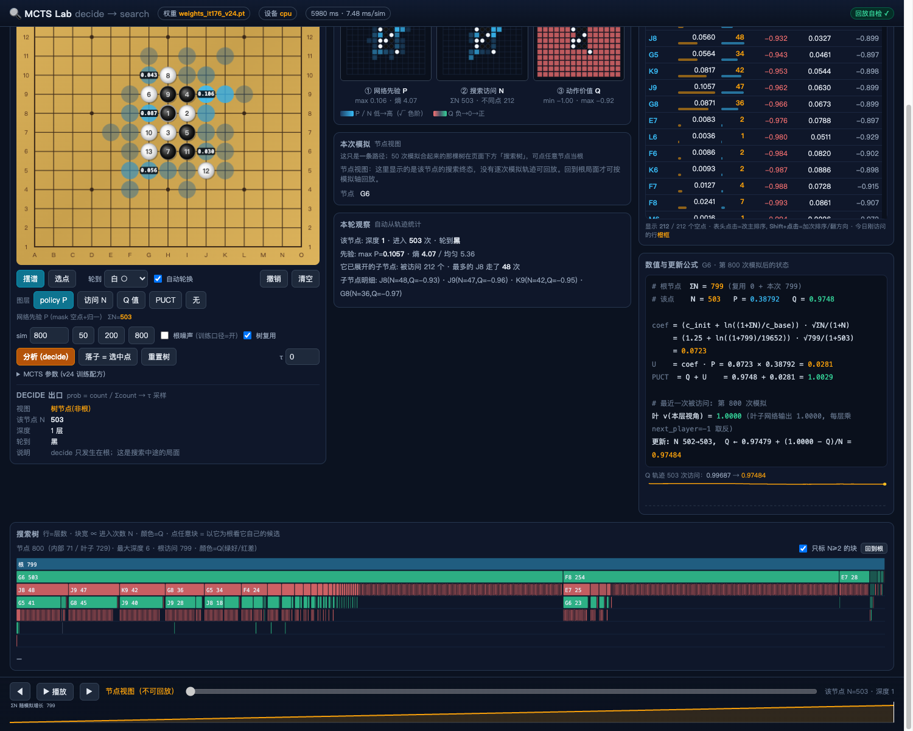

# Gomoku v24 MCTS Lab

把 `Gomoku-v0_pt_v24.py` 里的 **decide → search** 过程摊开来看：摆一个局面，看网络先验怎么被 50/200/800 次搜索改写、每条边被访问几次、Q 怎么一步步入账、公式里每个数是多少。

权重锁定 **v24 `weights_it176_v24.pt`**，网络与搜索逻辑**直接 `importlib` 加载 v24 原文件**（一行没改），只在外层包一层追踪器记录每次 `search()` 的递归路径 —— 所以画出来的永远是训练代码真实发生的过程，不会和源码漂移。



## 启动

```bash
./run.sh                  # → http://127.0.0.1:5055
lsof -tiTCP:5055 -sTCP:LISTEN | xargs kill     # 停
```

仓库是**自包含**的：`vendor/Gomoku-v0_pt_v24.py`（v24 训练脚本快照）+ `weights/weights_it176_v24.pt`（演示权重）
都在库内，克隆下来找得到 python 环境就能跑，不需要另配路径。

依赖：`flask` / `numpy` / `torch` / `gym` / `boardgame2`。
`run.sh` 按 `$PY` → 仓库内 `.venv` → 本机训练 venv → `python3` 的顺序找解释器。

要换权重/换版本（比如测 it200、或者换 v36 的网），用环境变量覆盖即可：

```bash
PY=/path/to/venv/bin/python \
V24_PY=/path/Gomoku-v0_pt_vXX.py \
V24_W=/path/weights_itXXX_vXX.pt \
LAB_PORT=5055 \
./run.sh
```

### ⚠️ 关于库里的演示权重

`weights/weights_it176_v24.pt` 是 **v24 训练到 it176 时的一副快照，仅作演示/复现界面行为用**：

- **不代表项目最强水平**，也不保证棋力、不保证代表性与稳定性（那一代之后还在继续训练）
- 用它复现出来的现象（含 value 头饱和、搜索散开）**是这副权重的真实行为**，不是 bug
- 想复现自己的实验，请用 `V24_W` 指到你自己的权重
- 文件 9.6 MB，`sha256 ed21329a…f0a67`（仅用于校验文件完整，**不用于判断权重同一性**——
  权重同一性要比 tensor 值，不能比字节/md5）

## 页面怎么用

**move 轴（一步步往下走）**
1. 左键点棋盘摆谱（数字=落子顺序），右键删子，「轮到谁」自动推断，可手改
2. `分析 (decide)` → 50 次模拟，树建好
3. 「选点」模式点任意空点 → 右侧公式面板显示该点的 P/N/Q/U/PUCT 与最近一次更新
4. `落子 = 选中点` → 走一手，**子树保留成新根**再分析（看到 `复用 40 + 本次 50`）

**sim 轴（搜索过程回放）**
- 底部滑杆 0↔50（或 200/800）拖任意切点，三张热力图、候选表、公式数值全部按该时刻重算
- `▶ 播放` 连续播放；每次只拖动不重发请求（一次拿全部轨迹，前端本地重放）

## 四个面板在说什么

| 面板 | 内容 |
|---|---|
| 主棋盘图层 | `policy P` 网络先验 / `访问 N` / `Q 值` / `PUCT` |
| 三个视角 | 同一局面 P/N/Q 三张对照图（悬停任意图→弹出 420px 放大版，带坐标与数值标注；挪开收起） |
| 本次模拟 | **逐帧播放一次 search**：起点 → 前向逐层（每层带 ΣN/P/Q/coef/U/PUCT/排名/次名）→ 叶子展开（网络 v）→ 回溯逐层（N→N+1、Q 更新，叶子→根） |
| 候选点 | **全部空点列出**（滚动条）· P/N/Q/U/PUCT 五个键都能排序：点键=主排序(再点翻方向)、Shift+点=加次级(上标=层级)、`默认`=回 **Q↓→P↓→N↓** · 刚被访问的行橙框 + Q 四位小数带 ↑↓ |
| 数值与更新公式 | `coef`、`U=coef·P`、`PUCT=Q+U`、`N→N+1, Q←Q+(v−Q)/N` 全部带数 + Q 轨迹折线 |
| 本轮观察 | 自动统计：先验熵、集中度、先验↔搜索 top5 重合、平均深度、value 饱和率、计数平局、argmaxN vs argmaxQ |
| 搜索树 | 冰柱图：行=层数，**块宽 ∝ 进入次数 N**，颜色=Q；兄弟块可按 **N / Q / P** 重排；`试过就弃`（N=1 且 Q<0）用红色虚线框标出。点任意块 → 以该节点为根，重绘棋盘/三视角/候选表/公式；顶部显示 `根 → G6 → J4` 路径，`回到根` 复原 |
| 双代并排 | 头部 `⚖ 并排对比` → 选两副权重、同一局面同一 sim，各自 decide；并排看 policy 热力、选点、根 value、候选表 + 差异（选点是否一致 / Δvalue / policy KL / max|ΔP| / 访问 top5 重合） |

## 一次 search 的内部过程（逐帧）

「本次模拟」面板可以一帧帧走完一次 `search()`，这是 v24 递归的真实时序：

```
帧1 起点        根局面，进入 N 次
帧2 前向 第1层   根 → F8   排名 1/213  ΣN=31 P=0.2533 Q=0.6542
                 coef = (c_i+ln((1+ΣN)/c_b))·√ΣN/(1+N) = 1.7422
                 U = coef·P = 0.4413   PUCT = Q+U = 1.0955   次名 G6=1.0917（只差 0.0038）
帧3 前向 第2层   F8 → E7   ΣN=2 ...
帧4 前向 第3层   E7 → A15  ΣN=0 → coef=0 → 全点 PUCT=0（全平局）→ 取扫描顺序第一个
帧5 叶子展开     网络输出 v = -0.1191（该叶子自身视角）· 本次调用不加任何 count
帧6 回溯 第3层   A15   v=+0.1191  N 0→1  Q 0.0000→0.1191
帧7 回溯 第2层   E7    v=-0.1191  N 1→2  Q 0.0289→-0.0451
帧8 回溯 第1层   F8    v=+0.1191  N 3→4  Q 0.6542→0.5204  回到根，本次模拟结束
```

两个容易忽略的点：

- **回溯是从叶子往根**的（递归返回时才更新），而且每上一层 `v` 乘一次 `next_player(−1)`，
  所以同一组帧里 `+0.119 → −0.119 → +0.119 → −0.119` 交替
- **新展开节点的第一层是"全 0 平局"**：`ΣN=0 → coef=0 → U=0 → Q 也还是 0`，所有合法点 PUCT 相同，
  `nanargmax` 取棋盘扫描顺序的第一个 → 这就是 A15/A1 这类角落反复出现的机制，不是网络偏好

## 搜索树怎么读

树是**所有模拟累积**出来的，不是某一次模拟的路径（单次路径在「本次模拟」面板）。

- **行 = 层数**：第 0 行是根，第 1 行是根的所有候选，往下依次
- **块宽 ∝ N**：宽度就是"搜索预算分了多少给这个分支"；同一父节点下的块加起来不超过父块的宽度
- **颜色 = Q**：绿 = 对该方有利，红 = 不利，灰 = 接近 0；根块是蓝色（没有父边）
- **点任意块** → 该节点成为"根"：棋盘换成那个局面（多出路径上的手数），三视角/候选表/公式全部换成**它自己的** 225 个候选。
  节点视图是**静态终态**，不能用模拟轴回放（后端没有为每个节点存逐次轨迹）

实测形状（12 子中盘，白先）：

| sim | 节点 | 内部 | 叶子 | 最大深度 |
|---|---|---|---|---|
| 50 | 50 | 4 | 46 | 3 |
| 200 | 200 | 6 | 194 | 4 |
| 800 | 800 | 71 | 729 | 6 |

**98% 的节点是叶子（N=1）**，树是"扫把形"——预算摊在一大片只探过一次的点上，而不是往深处钻。
配合「本轮观察」里的 `叶子 value 饱和 191/200` 一起看：值头饱和 → 每个新叶子都返回 ±1 → PUCT 无从比较 → 继续开新点。

### 节点的 N 是什么口径

`N(节点) = 进入该节点的次数 = 父节点那条边的计数`（就是 decide 里 `prob = count/Σcount` 用的数）。
根没有父边，用 `count` 总和。

⚠️ v24 只给**内部节点**建 `count`（叶子的 `policy` 有、`count` 没有：展开后直接返回，由父节点 +1）。
所以叶子节点的 N 取自父边计数，显示为 1（被到达一次就展开了，再来就会变成内部节点）。
后端有一致性自检：导出的树与"从模拟轨迹重建的树"逐节点比对，200/200 路径与 N 全等。

## 排序 ≠ 选点口径

候选表默认按 `Q↓→P↓→N↓` 排（方便看哪些点价值高），但 **v24 的 decide 出口是按访问次数 N 采样**：
`prob = count / Σcount`，再按温度 τ 抽（τ≤0.01 = argmax N）。**不是 argmax Q**。

原因（实测 200 次模拟，中盘局面）：

- argmax Q 与 argmax N 在 200 次模拟里只分叉 2 次（k=3、k=16），且分叉时 Q 榜首都只有 **N≤2** 的样本
- 分叉样例：k=3 时 `A15(N=1,Q=−0.173)` vs `G6(N=1,Q=+0.997)` —— 两个都只有单次叶子采样，Q 就是在比"哪次前向传播恰好给了高分"
- 值头饱和时更危险：同一局面 200 次模拟里 **191/200 个叶子 |v|>0.95**，N=1 的 Q 会直接是 ±1.000
- N 是"搜索预算分配的结果"，方差小；Q 是均值，样本少时方差大。PUCT 内部已经用 Q 引导访问，所以搜索成熟后两者天然一致（这就是为什么最终都指向 G6）

页面「本轮观察」会实时对比这两个口径，分叉时标红并注明 Q 榜首的样本数。

## 口径（和训练一致 / 不一致的地方）

- **sim=800 = 训练口径**；默认 50 只为看得清、点得快（CPU 5~8 ms/sim，800 约 6 s）
- **根噪声默认关**（`训练口径=开`）：开 = 根先验混 `Dirichlet(α=0.03)`、ε=0.25，只注入一次，全部 sim 共用
- `τ` 默认 0（argmax）；训练是 `τ = max(0.05, exp(−(step−4)/8))`
- **树复用**默认开：v24 只在每局开始 `reset_mcts()`，所以回合间子树保留，新根进场就带上一手的访问数
- 刷新页面 = 新会话，会自动 `reset_mcts()`（否则 ΣN 会莫名翻倍）

## 自检

后端每次分析都会用轨迹重放 count 增量，与 `agent.count` 的真实增量逐格比对，结果放在右上角徽标与「decide 出口」里（`回放自检 ✓`）。前端 Q 也是同一条轨迹重放出来的，实测与 `agent.q` 差 < 1e-5（float32 舍入）。任何一处对不上就是红的，不会静默。

## 截图

| 放大三视角之一（悬停触发） | 走一手后 value 头饱和，搜索被打散 |
|---|---|---|
|  |  |

搜索树（800 sim，点了 G6 当根）：



第二张是 lab 自己抓出来的真实现象：白走 G6 后轮到黑，50 次模拟落在 **50 个不同点、每个 N=1、Q 全是 −1.000**，
`prob` 出现 90 个并列 → `argmax` 退化成"第一个合法点"，decide 选了 A15。页面的「本轮观察」会直接标红：

```
叶子 value 饱和(|v|>0.95) 50/50  ← value 头在绝大多数叶子上给出 ±1
prob 最高值有 90 个并列 → τ=0 的 argmax 退化为"第一个并列点"
平均路径深度 1.0 层
```

## 仓库结构

```
server.py                     # Flask 后端: 加载 v24 原模块 + 追踪器 + /api/analyze
static/index.html             # 单页前端(棋盘/热力图/候选表/公式/模拟轴), 无外部依赖
run.sh                        # 一条命令启动(自动找解释器, 可用环境变量覆盖)
vendor/Gomoku-v0_pt_v24.py    # v24 训练脚本快照 —— 被追踪的就是它, 一行未改
weights/weights_it176_v24.pt  # 演示权重(见上面 ⚠️ 说明)
docs/                         # 截图
```

接口：

- `GET  /api/status` — 当前权重/设备/树规模
- `POST /api/reset` — `agent.reset_mcts()`
- `POST /api/analyze` — 摆谱写 `stones:[[r,c,v],…]`，返回**一次 decide 的完整轨迹**：
  每模拟的路径 `{a:[[r,c],…], v:[逐层v], k:[leaf|node|terminal]}`、根策略、访问数、Q、`tree`、以及 `selfcheck`
- `POST /api/node` — 传 `{"path":[[r,c],…]}`，重演到树中任意节点，返回**该节点自己的 225 个候选**
  （`policy` / `count` / `q` / `stones` / `n_total`）。叶子节点也能查（有 policy 就够）
- `GET  /api/weights` — 可用权重清单（仓库 `weights/` + 训练目录的 `*.pt`）
- `POST /api/compare` — 传 `{"stones":…,"sim":…,"weights":[A,B]}`，两副权重各自独立 decide 一次，
  返回各自 `policy/count/q/chosen/v_root/ms`（用独立 agent + `reset_mcts`，不碰主页面的树）
- 一次请求返回全部轨迹（800 sim ≈ 200KB），前端本地重放 → 拖滑杆零延迟、不重复打网

## 已知限制

- **单会话**：树存在服务端一个 agent 里，两个标签页会互相干扰（换页先刷新）
- 树浏览器目前是**冰柱图 + 点击下钻**；没有力导向/折叠树视图，也没有"按 Q 重排兄弟节点"的选项
- 节点视图只能看到该节点的**终态**统计，看不到它内部每次模拟的轨迹（后端未按节点存）
- 双代并排只给"各自 decide 一次 + 摘要"，不做逐 sim 交叉对比，也没有棋力结论（要强度请跑 PK）
- 每次并排会把新权重加载进内存（约 10MB/副），换多了会堆着
- 噪声注入用 `np.random`，要可复现就传 `seed`
