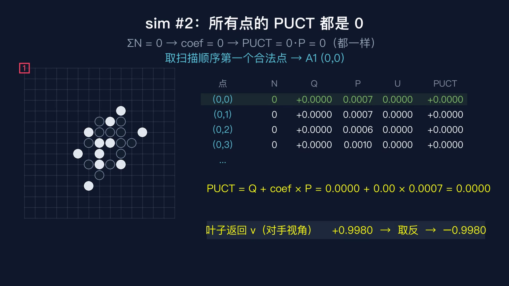
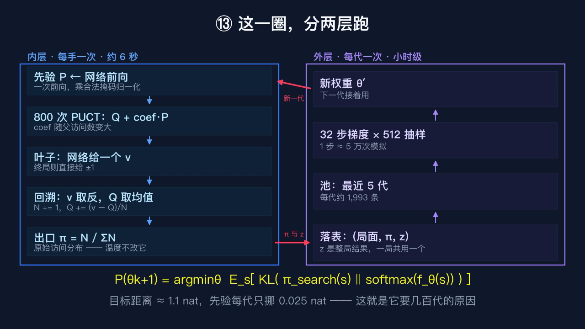
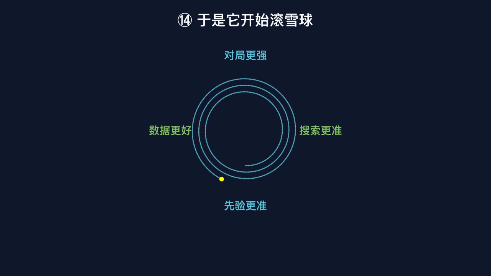
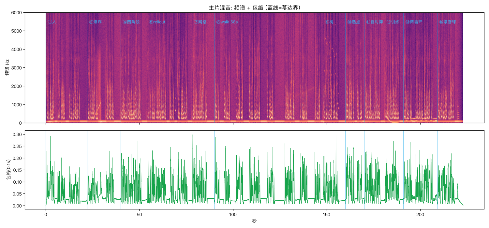
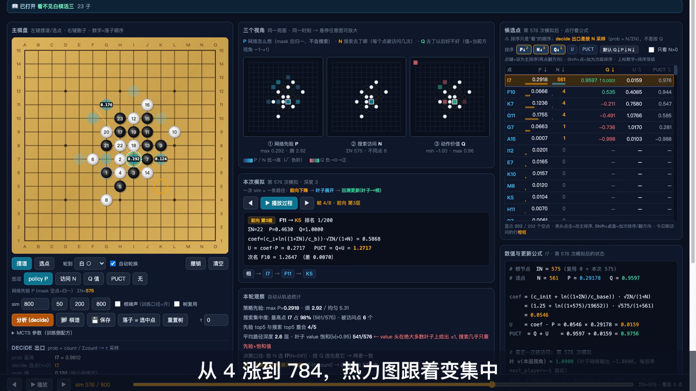
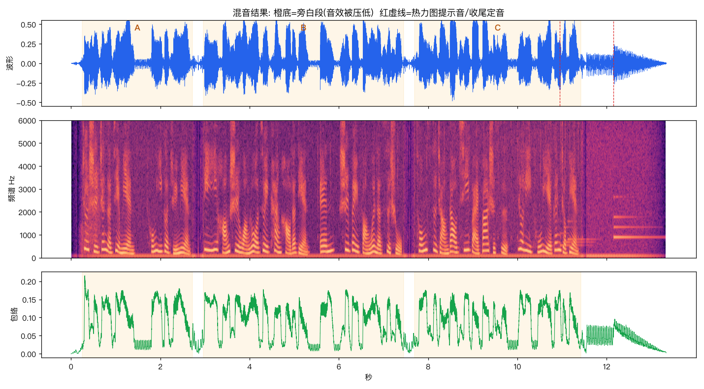

# 视频：一次 MCTS 决策，拆开来看

**成片**：[`mcts_explained_720p.mp4`](mcts_explained_720p.mp4) — 3 分 43 秒，1280×720，30fps。

一部讲「AlphaZero 式 MCTS 为什么有效」的科普片。**片子里每一个数字都是本仓库跑出来的实测值**，
不是示意——包括那次逐步讲解的 trace。

| 剧照 | |
|---|---|
|  |  |
| ① 人类读棋：白堵一头，黑另一头成活四 → 回退 → 改走自己的活四 | ⑧ 逐 sim：每一步的 N / Q / P / U / PUCT 都在表里 |
|  |  |
| ⑬ π 的更新路径：内层每手 6 秒，外层每代小时级 | ⑭ 滚雪球：先验 → 搜索 → 数据 → 先验 |

## 14 幕

| # | 幕 | 时长 | 屏幕上的话 |
|---|---|---|---|
| — | 开场 | 6s | 「你下棋的时候，脑子里在干什么？」 |
| ① | 先说人。你落子之前，脑子里在干嘛？ | 16s | 只扫 4 个点 → 堵一头被反杀 → 回退 → 我自己成四 |
| ② | 换机器来。它没有这个本事 | 10s | 200 个点往下 20 层 ≈ 10^46 |
| ③ | 所以卡住的，从来不是算得快 | 8s | 它不知道该看哪儿。这才是死结 |
| ④ | 2006 年，有人换了个思路：干脆不评估了 | 14s | 选择／扩展／模拟／回传，绕一圈 = 一次模拟 |
| ⑤ | 听起来挺美。可它有个坑 | 12s | 试到 2000 次稳在 52.3%，网络说白只有 35% |
| ⑥ | 还有个问题：先试哪个？ | 12s | A 赢面高但试了 8 次，U 掉到 0.040 |
| ⑦ | 2016 年，神经网络进场了 | 12s | 一次前向给一个数；还能说该看哪儿 |
| ⑧ | **现在把时钟拨慢，看它走一步** | **58s** | **第 1 次只展开根；第 2 次全零 PUCT 按扫描顺序；第 3 次 coef 生效……** |
| ⑨ | 800 次算完，这棵树长这样 | 12s | 790 个局面，8 层深，75% 的边只走一次 |
| ⑩ | 答案：数一下谁被访问得最多 | 10s | 它选了 (8,8)，84.6% |
| ⑪ | 到这儿它能下棋了。可它还不会变强 | 11s | 于是自己跟自己下，10,456 局 |
| ⑫ | 这些数据，回头再喂给它自己 | 10s | 搜索当老师，网络当学生 |
| ⑬ | 这一圈，分两层跑 | 18s | 内层每手 6 秒（800 次模拟）；外层每代小时级（1,993 条样本、32 步梯度）；`P(θk+1) = argminθ E[KL(π_search ‖ softmax(f_θ))]` |
| ⑭ | 于是它开始滚雪球 | 14s | 「它没有棋谱，也没有老师」「它的老师，就是它自己」 |

### 文案风格

按科普博主的口语写：开场先抛问题，句子短，少用「不是…而是…」这类对称断言；
每个结论都跟一个具体数字，结尾落在情绪上而不是口号上。

## ⑬ 那张图对应什么

⑬ 是把两张表串成一个闭环：**内层**（每手一次，约 6 秒）跑 800 次模拟得到访问分布 π；
**外层**（每代一次，小时级）把 1,993 条 `(局面, π, z)` 拿去训 32 步梯度，得到新权重 θ′，
再回到内层的先验。两层唯一的接口就是那张表。

它回答的是「为什么提升得慢」：目标距离 ≈ 1.1 nat，而先验每代只挪 0.025 nat ——
不是训练不动，是每代能搬的就那么多。


## 补充片段：真界面里的 800 次模拟

`lab-panel-800sim.mp4` — 13.3s / 1280×720 / 15fps / 1.1MB

主片 ⑧ 是动画讲原理，这一段是**本仓库自己的 Web UI 实录**：同一个局面（23 子）跑 800 次模拟，
从 sim 4 播到 sim 800，看得见候选点的 N 从 4 涨到 784、三个视角的热力图从空白变成集中、
「本轮观察」里的饱和计数一行行冒出来。


怎么录的（不是屏幕录制）：

1. 在 lab 里载入局面、`sim=800`、关闭树复用、点分析
2. 逐段设置 `S.k`（第几次模拟）+ `renderAll()`，每 4 次模拟抓一帧 → 200 帧
3. `ffmpeg -framerate 15 -i f%05d.png -vf "crop=1600:900:0:50,scale=1280:720" ...`

这样每一帧都是确定性的，不受录屏掉帧/系统动画影响。


### 全片配音 · `mcts_explained_voiced.mp4`

3:43 / 8.4MB。画面流**原样 copy 不重编**，只加一条音轨：26 句旁白 + 一层音效床。

旁白由本地 IndexTTS-2.5 生成（`~/tts/ref_zf001.wav` 参考音色，science 腔），26 句各自独立成轨、
按幕对位 —— 每句都落在自己那一幕的窗口里，实测偏差 ≤ 0.05s。

| 起点(s) | 长度 | 旁白 |
|---|---|---|
|    0.35 |  4.25 | 十五乘十五的棋盘，一次八百遍模拟。我们把它拆开看。 |
|    6.35 |  4.03 | 你其实只看了四个点。堵这头，它反手那头，成活四。 |
|   12.50 |  5.63 | 换个方向，自己先成四，三步就够。剩下快两百个点你压根没算，先筛掉了。 |
|   22.40 |  5.49 | 机器没这个本事，它不会先筛。两百个点往下二十层，这个数大到没法念。 |
|   32.40 |  3.91 | 真正卡住它的，是不知道该看哪儿。算得再快也没用。 |
|   40.40 | 10.67 | 零六年，有人换了个思路：别急着评估，先算。挑一条路走到头，瞎走到终局，结果原路写回。绕一圈算一次，绕八百圈，答案自己浮出来。 |
|   54.30 |  9.97 | 听起来挺美，可它有坑。随便走出来的结果特别抖，抽十次和抽两千次能差十几个点。而且两边都在乱下，谁都不防守。 |
|   66.35 |  2.17 | 还有个问题：先试哪个。 |
|   70.30 |  5.37 | 试得越多越不值钱，没试过的反而更容易被选中。这一下叫探索。 |
|   78.40 |  7.65 | 一六年，网络进场。它把瞎走到终局换成一次前向，还顺便说该看哪儿：前十个点，吃掉九成先验。 |
|   90.20 |  2.57 | 现在把时钟拨慢，看它走一步。 |
|   95.20 |  3.29 | 先问网络。它只给概率和估值，不给答案。 |
|  101.70 |  3.73 | 第一次进去，一个点都还没落。算完先验就退出来。 |
|  108.70 |  5.87 | 第二次，所有点的分数全是零，因为系数还是零。程序按顺序，随手取了 A 一。 |
|  118.20 |  3.91 | 第三次，系数终于不是零了。先验最高的那个点，赢。 |
|  127.70 |  5.17 | 第四次，它回到刚才那条路。可进去之后又全是零，只好再来一遍。 |
|  135.70 |  4.07 | 十四次了。数一下每个点被走过几次，答案就出来了。 |
|  143.70 |  2.95 | 八百次，就是把这一套重复八百遍。 |
|  148.40 |  7.75 | 八百次算完，树长这样。七百九十个局面，最深钻到八层。可有四分之三的边，一辈子只走过一次。 |
|  162.35 |  4.45 | 它选了八八那个点。这个答案不是它想出来的，是数出来的。 |
|  167.15 |  2.53 | 它不用懂棋，只要把预算分对。 |
|  170.40 |  8.31 | 它会下棋了，可还不会变强。自己跟自己下，一局接一局，没有棋谱可背。每手记三样：局面、搜索分布、最后谁赢。 |
|  181.40 |  7.33 | 这些数据回头再喂给它。搜索当老师，网络当学生，把八百次模拟的结论，压成一次前向的直觉。 |
|  191.40 |  4.09 | 这一圈分两层跑：内层每手一次，外层每代一次。 |
|  197.50 |  9.07 | 目标不是更正确的棋，是这八百次搜索自己的结论。两者差一点一纳特，一代只挪零点零二五，所以要几百代。 |
|  209.40 |  8.79 | 于是它开始滚雪球。先验更准，搜索更准，对局更强，数据更好。它没有棋谱，也没有老师。它的老师，就是它自己。 |

音效 cue（全部锚在 `render.py` 里确认过的时刻）：

| 时刻 | 元素 |
|---|---|
| 全程 | 55Hz drone（−37dB）+ 气息（−50dB） |
| 6/22/32/40/54/66/78/90/148/160/170/181/191/209 | 转场 whoosh 0.55s |
| 22.0 → 29.3 | 爆炸 riser 60→400Hz，顶到「10^46 种可能」那一刻 |
| 29.3 | 44Hz 低频 boom（全片峰值最大） |
| 40.5 / 43.8 / 47.1 / 50.4 | 四阶段 4 个木点 |
| 54.5–65.5 | rollout 抖动纹理，幅度随抽样收敛 |
| 69.2 / 73.0 | 探索 A/B 两声 ping（E5 / A5） |
| 78.3 | 网络进场上扫 180→800Hz |
| 83.0–84.6 | 先验柱 10 个高音点 |
| 90.35–143.3 | **滴答 113 枚**，0.95s 匀速 → 末段 0.13s，跟着 8 个 beat 走 |
| 148.15 | 树生长 boom + 26 个 sparkle |
| 162.6 | 选定 (8,8) 定音（C6+G6） |
| 170.4–180 | 自对弈 20 声落子 |
| 181.4–188.9 | 训练下降扫频 420→70Hz |
| 191.4–208.9 | 两层循环双频脉冲（内 0.85Hz / 外 0.19Hz） |
| 210.0 | 滚雪球 4 音上行琶音 |
| 220.0 | 收尾和弦 A3-E4-A4-C#5-A5，长衰减 2.6s |



口径与实测：

- 旁白覆盖 143s / 223s = **64%**；旁白段音效自动 duck 到 0.38（≈−8.4dB）
- 26 句全部落在预算内（最长一句 10.67s，预算 12.60s）
- 成片 mean −19.7dB / peak −3.3dB；`silencedetect` 复核 26/26 句起点，偏差 +0.01~+0.05s
- `pick1` 手工后移到 162.35s —— 原稿 160.4s 会比画面「它选了 (8,8)」（162.6s）早 2.2s，成了剧透
- 复现：`video/narration/` 下四个文件（口播稿 json / TTS 逐句生成 / 音效合成 / 混音），
  `tts_scenes.py` 依赖 `~/tts/index-tts` 与 `~/tts/narrate.py`

### 带旁白与字幕的版本

`lab-panel-800sim-voiced.mp4` — 13.3s / 1.3MB，在无声版上叠了 3 句旁白 + 底部通栏字幕。

| 时间 | 旁白 = 字幕 |
|---|---|
| 0.25 – 2.72 | 这是真的界面 —— 同一个局面 |
| 2.97 – 7.45 | 第一行是网络最看好的点，N 是访问次数 |
| 7.70 – 11.42 | 从 4 涨到 784，热力图跟着变集中 |



做法（两个坑已经踩过）：

- **配音**：`text_to_speech` 走的 edge-tts 在本机返回 403（微软已封），改用 macOS 自带
  `say -v Tingting -r 185`。中文实测约 4.5 字/秒，写稿时按这个估时长。
- **字幕**：不用 ffmpeg `drawtext`（字体路径转义 + .ttc 支持都容易翻车），
  改 matplotlib 渲**透明 PNG**（底部通栏 + 居中文字），再用 `overlay` + `enable='between(t,a,b)'` 叠上去。
- 三条音轨用 `aresample=44100,adelay=<ms>| <ms>` 定位、`amix=normalize=0` 混合、`apad=whole_dur` 补齐到片长。


### 音效（`lab-panel-800sim-sfx.mp4`）

13.3s / 1.5MB，在配音版上再叠一层音效床。全部用 numpy 现场合成，没有引外部素材。

| 元素 | 时间 | 做法 | 电平（实测） |
|---|---|---|---|
| 低频垫 55Hz+五度+八度 | 全程 | 三条正弦 + 0.13Hz 呼吸 + 40–260Hz 带通 | −31.5 dB RMS |
| 房间气息 | 全程 | 300–5000Hz 粉噪，极轻 | −44 dB RMS |
| 开场 whoosh | 0.12–0.74s | 噪声 300→3200Hz 扫频 | −30 dB |
| 滴答 ×50 | 0.40–11.45s | 带通噪声爆点，间隔 0.46→0.088s 递减，音高 1800→4000Hz | 峰值 −21 dB |
| 收拢提示音 | 10.95 / 11.04 / 11.12s | C5-E5-G5 三连铃 | −30 dB |
| 收尾定音 | 12.15s | A5(880Hz) 长衰减 + 八度泛音 | −24 dB |



混音口径（可复核）：

- 每一层先按**目标 RMS** 定标再叠，不靠耳朵调；归一化只做 −3dBFS 软膝限幅、**不放大**（先写错过一版：按峰值归一会把垫子整体抬高 12dB）
- 旁白三段（0.25–2.72 / 2.97–7.45 / 7.70–11.42）自动 duck 到 0.40（≈−8dB），120ms 斜坡
- 最终实测：整体 mean −18.9dB / peak −3.0dB（无削顶）；句A −18.1、空隙 −30.7/−33.4、滴答末 −25.3
- 滴答的加速是**音乐上的棘轮**，不是 sim 计数的 1:1 映射（800 次 / 13.3s = 60 次/秒，1:1 会变成蜂鸣）

## 数字的来源（都能复现）

| 片子里的数字 | 来自 |
|---|---|
| v = −0.3000、sim #1~#4 的完整 PUCT 表、π(8,8)=84.6% | `regen_trace.py` → `trace_23stones.json`（本目录） |
| 白 (8,8) 成活四、黑 (6,10)/(8,10) 活三、白堵后被反杀 | 威胁检测脚本（活三 / 冲四 / 活四判定），局面见 trace |
| 2000 次 rollout = 52.3%，±5% 需 383 次 | 2000 次随机走到终局的实测 |
| 网络给 −0.30（白 ≈ 35%） | 同一权重的先验 v |
| 10,456 局 / 108 代 / 每代 ~97 局 / 1,993 条样本 | `replay_pool_index.json`（训练侧统计） |
| 790 局面 / 75% 的边只走一次 | 800 sim 后的树统计 |
| KL(网络‖搜索) 0.49~1.41 | 5 个检查点 × 5 个中盘局面 |

## 重渲

```bash
# 依赖：matplotlib（CJK 字体用 PingFang SC）+ ffmpeg
python video/render.py            # 逐帧写到 video/frames/（6150 帧，约 5 分钟）
ffmpeg -y -framerate 30 -i video/frames/f%05d.png \
       -c:v libx264 -pix_fmt yuv420p -crf 18 -movflags +faststart video/mcts_explained_720p.mp4
```

- 换个输出目录：`FRAMES_DIR=/tmp/frames python video/render.py`
- 只重渲某一幕（改完某幕不用重跑全片）：

```python
import importlib.util
spec = importlib.util.spec_from_file_location("r", "video/render.py")
r = importlib.util.module_from_spec(spec); spec.loader.exec_module(r)
OFF = int(90 * r.FPS); N = int(58 * r.FPS)        # ⑧ 从第 90 秒开始，58 秒长
for k in range(N):
    fr = r.Frame(); r.s_walk(k / r.FPS, fr); fr.save(OFF + k)
```

## 重新生成 trace（⑧ 的数据）

```bash
python video/regen_trace.py \
  --   # 默认用 vendor/ 的脚本快照 + weights/ 的权重
MODEL_PY=/path/to/Gomoku.py MODEL_W=/path/to/weights.pt python video/regen_trace.py
```

`regen_trace.py` 会把每一层选点前的完整 PUCT 表（候选 / N / Q / P / U / PUCT）、被选点排名、
叶子估值、回传值全部记下来；`render.py` 里 ⑧ 的 `BEATS` / `TAB5` 就是照它填的。

## 为什么不用 Manim

试过：`pip install manim` 卡在 `pycairo` 需要系统原生 cairo（本机没有 Homebrew / pkg-config / cmake）。
于是走 matplotlib 逐帧 + ffmpeg 合成——代价是没有 morph 过渡，好处是每一帧的排版都能精确控制，
而且 CJK 字体（PingFang SC）验证过零缺字。

## 已知的诚实点

- ⑧ 里搜索最后选的 (8,8)，**恰好就是 ① 里人类一眼看出的那步活四**。但网络自己的估值是
  −0.30（白略差），与「这是必胜手」矛盾 —— 这是价值头会看错的现成例子，片子里没有点破，留作解读空间。
- ① 里「人类先看这 4 个点」的取点是按真实战术点（活三两端 / 能成四的点）算的，
  不代表任何具体棋手的实际思考顺序。
