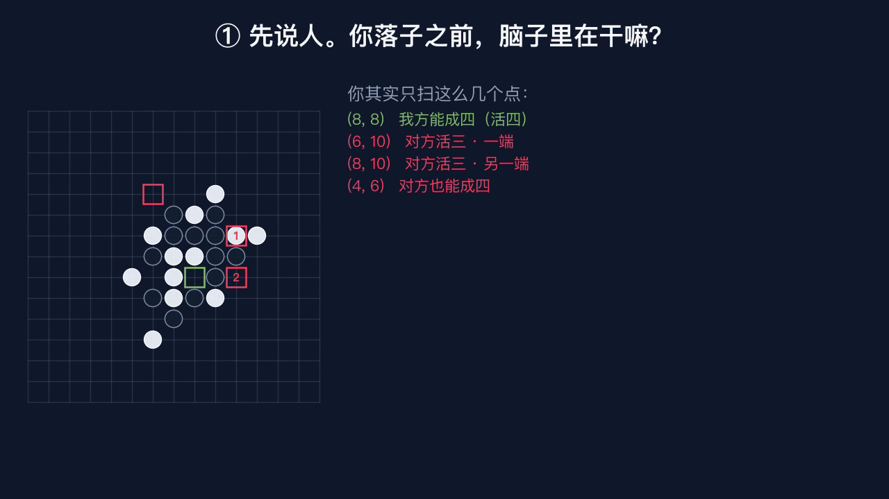
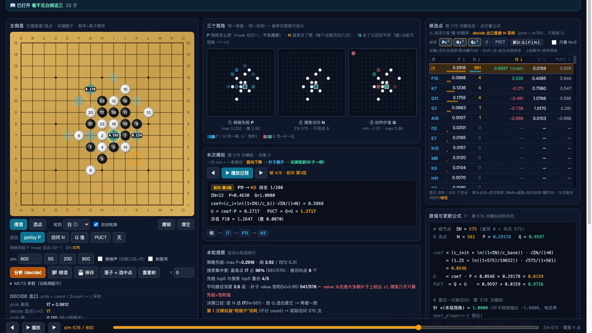

# 视频：一次 MCTS 决策，拆开来看

**成片**：[`mcts_explained_720p.mp4`](mcts_explained_720p.mp4) — 3 分 43 秒，1280×720，30fps。

一部讲「AlphaZero 式 MCTS 为什么有效」的科普片。**片子里每一个数字都是本仓库跑出来的实测值**，
不是示意——包括那次逐步讲解的 trace。

| 剧照 | |
|---|---|
|  |  |
| ① 人类读棋：白堵一头，黑另一头成活四 → 回退 → 改走自己的活四 | ⑧ 逐 sim：每一步的 N / Q / P / U / PUCT 都在表里 |
|  |  |
| ⑬ π 的更新路径：内层每手 6 秒，外层每代小时级 | ⑭ 滚雪球：先验 → 搜索 → 数据 → 先验 |

## 14 幕

| # | 幕 | 时长 | 屏幕上的话 |
|---|---|---|---|
| — | 开场 | 6s | 「你下棋的时候，脑子里在干什么？」 |
| ① | 先说人。你落子之前，脑子里在干嘛？ | 16s | 只扫 4 个点 → 堵一头被反杀 → 回退 → 我自己成四 |
| ② | 换机器来。它没有这个本事 | 10s | 200 个点往下 20 层 ≈ 10^46 |
| ③ | 所以卡住的，从来不是算得快 | 8s | 它不知道该看哪儿。这才是死结 |
| ④ | 2006 年，有人换了个思路：干脆不评估了 | 14s | 选择／扩展／模拟／回传，绕一圈 = 一次模拟 |
| ⑤ | 听起来挺美。可它有个坑 | 12s | 试到 2000 次稳在 52.3%，网络说白只有 35% |
| ⑥ | 还有个问题：先试哪个？ | 12s | A 赢面高但试了 8 次，U 掉到 0.040 |
| ⑦ | 2016 年，神经网络进场了 | 12s | 一次前向给一个数；还能说该看哪儿 |
| ⑧ | **现在把时钟拨慢，看它走一步** | **58s** | **第 1 次只展开根；第 2 次全零 PUCT 按扫描顺序；第 3 次 coef 生效……** |
| ⑨ | 800 次算完，这棵树长这样 | 12s | 790 个局面，8 层深，75% 的边只走一次 |
| ⑩ | 答案：数一下谁被访问得最多 | 10s | 它选了 (8,8)，84.6% |
| ⑪ | 到这儿它能下棋了。可它还不会变强 | 11s | 于是自己跟自己下，10,456 局 |
| ⑫ | 这些数据，回头再喂给它自己 | 10s | 搜索当老师，网络当学生 |
| ⑬ | 这一圈，分两层跑 | 18s | 内层每手 6 秒（800 次模拟）；外层每代小时级（1,993 条样本、32 步梯度）；`P(θk+1) = argminθ E[KL(π_search ‖ softmax(f_θ))]` |
| ⑭ | 于是它开始滚雪球 | 14s | 「它没有棋谱，也没有老师」「它的老师，就是它自己」 |

### 文案风格

按科普博主的口语写：开场先抛问题，句子短，少用「不是…而是…」这类对称断言；
每个结论都跟一个具体数字，结尾落在情绪上而不是口号上。

## ⑬ 那张图对应什么

⑬ 是把两张表串成一个闭环：**内层**（每手一次，约 6 秒）跑 800 次模拟得到访问分布 π；
**外层**（每代一次，小时级）把 1,993 条 `(局面, π, z)` 拿去训 32 步梯度，得到新权重 θ′，
再回到内层的先验。两层唯一的接口就是那张表。

它回答的是「为什么提升得慢」：目标距离 ≈ 1.1 nat，而先验每代只挪 0.025 nat ——
不是训练不动，是每代能搬的就那么多。


## 补充片段：真界面里的 800 次模拟

`lab-panel-800sim.mp4` — 13.3s / 1280×720 / 15fps / 1.1MB

主片 ⑧ 是动画讲原理，这一段是**本仓库自己的 Web UI 实录**：同一个局面（23 子）跑 800 次模拟，
从 sim 4 播到 sim 800，看得见候选点的 N 从 4 涨到 784、三个视角的热力图从空白变成集中、
「本轮观察」里的饱和计数一行行冒出来。



怎么录的（不是屏幕录制）：

1. 在 lab 里载入局面、`sim=800`、关闭树复用、点分析
2. 逐段设置 `S.k`（第几次模拟）+ `renderAll()`，每 4 次模拟抓一帧 → 200 帧
3. `ffmpeg -framerate 15 -i f%05d.png -vf "crop=1600:900:0:50,scale=1280:720" ...`

这样每一帧都是确定性的，不受录屏掉帧/系统动画影响。

## 数字的来源（都能复现）

| 片子里的数字 | 来自 |
|---|---|
| v = −0.3000、sim #1~#4 的完整 PUCT 表、π(8,8)=84.6% | `regen_trace.py` → `trace_23stones.json`（本目录） |
| 白 (8,8) 成活四、黑 (6,10)/(8,10) 活三、白堵后被反杀 | 威胁检测脚本（活三 / 冲四 / 活四判定），局面见 trace |
| 2000 次 rollout = 52.3%，±5% 需 383 次 | 2000 次随机走到终局的实测 |
| 网络给 −0.30（白 ≈ 35%） | 同一权重的先验 v |
| 10,456 局 / 108 代 / 每代 ~97 局 / 1,993 条样本 | `replay_pool_index.json`（训练侧统计） |
| 790 局面 / 75% 的边只走一次 | 800 sim 后的树统计 |
| KL(网络‖搜索) 0.49~1.41 | 5 个检查点 × 5 个中盘局面 |

## 重渲

```bash
# 依赖：matplotlib（CJK 字体用 PingFang SC）+ ffmpeg
python video/render.py            # 逐帧写到 video/frames/（6150 帧，约 5 分钟）
ffmpeg -y -framerate 30 -i video/frames/f%05d.png \
       -c:v libx264 -pix_fmt yuv420p -crf 18 -movflags +faststart video/mcts_explained_720p.mp4
```

- 换个输出目录：`FRAMES_DIR=/tmp/frames python video/render.py`
- 只重渲某一幕（改完某幕不用重跑全片）：

```python
import importlib.util
spec = importlib.util.spec_from_file_location("r", "video/render.py")
r = importlib.util.module_from_spec(spec); spec.loader.exec_module(r)
OFF = int(90 * r.FPS); N = int(58 * r.FPS)        # ⑧ 从第 90 秒开始，58 秒长
for k in range(N):
    fr = r.Frame(); r.s_walk(k / r.FPS, fr); fr.save(OFF + k)
```

## 重新生成 trace（⑧ 的数据）

```bash
python video/regen_trace.py \
  --   # 默认用 vendor/ 的脚本快照 + weights/ 的权重
MODEL_PY=/path/to/Gomoku.py MODEL_W=/path/to/weights.pt python video/regen_trace.py
```

`regen_trace.py` 会把每一层选点前的完整 PUCT 表（候选 / N / Q / P / U / PUCT）、被选点排名、
叶子估值、回传值全部记下来；`render.py` 里 ⑧ 的 `BEATS` / `TAB5` 就是照它填的。

## 为什么不用 Manim

试过：`pip install manim` 卡在 `pycairo` 需要系统原生 cairo（本机没有 Homebrew / pkg-config / cmake）。
于是走 matplotlib 逐帧 + ffmpeg 合成——代价是没有 morph 过渡，好处是每一帧的排版都能精确控制，
而且 CJK 字体（PingFang SC）验证过零缺字。

## 已知的诚实点

- ⑧ 里搜索最后选的 (8,8)，**恰好就是 ① 里人类一眼看出的那步活四**。但网络自己的估值是
  −0.30（白略差），与「这是必胜手」矛盾 —— 这是价值头会看错的现成例子，片子里没有点破，留作解读空间。
- ① 里「人类先看这 4 个点」的取点是按真实战术点（活三两端 / 能成四的点）算的，
  不代表任何具体棋手的实际思考顺序。
